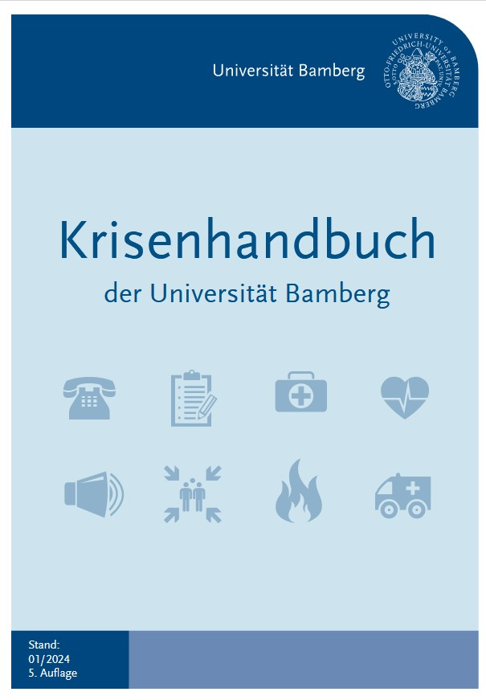
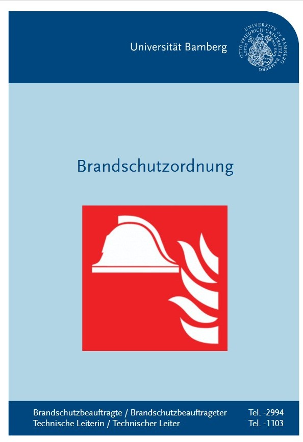

## Cybersecurity incidents

### When in doubt, report it immediately

If something seems suspicious, contact IT immediately — even if you have already clicked a suspicious link. It is better to report a possible incident once too often than once too little.

- **Suspected security incident:** [sicherheitsvorfall@fs.de](mailto:sicherheitsvorfall@fs.de)
- **Urgent support:** IT hotline, [+49 69 154008 - 111](tel:+4969154008111)
- **Technical problems or non-urgent requests:** IT ticket system

## Physical emergencies

Emergency procedures are stated here: [Krisenhandbuch der Universität Bamberg](https://www.uni-bamberg.de/sicherheit/krisenhandbuch/){target=_blank} and [Brandschutzordnung](https://www.uni-bamberg.de/fileadmin/www.abt-studium/Rechtsvorschriften/3Liegenschaften/Brandschutzordnung/Brandschutzordnung.pdf){target=_blank}

  
  
  

