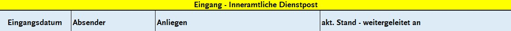
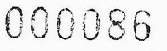
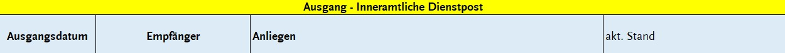

::: callout-note
TODO: integrate the Excel lists in a repository (private (e.g., Jour-Fixe agenda) or public?) - see mail-hub idea
:::

This section summarizes how the lab's official mail channels are managed.

## Incoming

- E-Mail is handled by the Team Assistant (e-mail: see team website).
- Physical mail is retrieved from the mailroom on a regular basis (Postfach Nr.: 44).
- Incoming physical mail is tracked in [Ausgangspost _Eingangspost.xlsx](){target=_blank}.



- Email: "Terminplanung" (UnivIS): primarily track the deadline for entering courses in FlexNow

## Processing

- **Physical mail** that needs to be archived in paper is added to [Archive](){target=_blank}:


  - Only mandatory documents are archived in paper form
  - They receive a unique ID `XXXXXX` (Paginierstempel)

  

  - Scanned and added to the [Archive]()

- Apply OCR (Nextcloud notifications are activated)

- Physical mail (documents) related to **theses**:

  - For signed topic confirmations, thesis supervisors update the [overview](https://github.com/fs-ise/theses-confidential/tree/main/theses){target=_blank}. Check and remind (if necessary): thesis advisors should have moved the documents related to the thesis to [35 theses](){target=_blank}.
  - Submissions, an issue must be created in the [theses-confidential](https://github.com/fs-ise/theses-confidential/issues){target=_blank}, uploading the digital version of the thesis. The paper version is [archived](/management/nextcloud.html) immediately.
  - Reviews are scanned, the PDF is added to 14.04, and the paper version is sent to the examination office (no cover letter, Hauspost: Ref II/3).

## Outgoing

::: resource

[Letter template](https://github.com/fs-ise/quarto-template-letter){target=_blank}.

:::

::: {.callout-note title="Default responses" collapse=true}

**Doctoral programme inquiries**

Use this response for inquiries about doctoral study. Before sending, verify the programme details, funding information, intake, and application deadline.

```text
Dear [Name],

Thank you for your interest in pursuing doctoral studies at Frankfurt School of Finance & Management.

Frankfurt School offers a structured, fully funded doctoral programme, including a Management concentration. Applications are handled centrally rather than through individual supervision arrangements.

I encourage you to review the programme details, admission requirements, and application process here:

[Programme URL]

The application deadline for the [Month Year] intake is [Day Month Year]. Successful applicants receive a tuition waiver and financial support.

I wish you all the best with your application.

Best regards,
[Your name]
```

:::

- Outgoing physical mail is tracked in [Ausgangspost _Eingangspost.xlsx](){target=_blank}.



- Outgoing physical mail is scanned and archived in the relevant project directories.
- Stamps are available at the Team Assistant's office.
